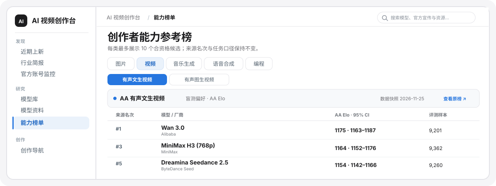

# AI 视频创作台

面向 AI 视频创作者的个人研究工作台：快速浏览模型发布、行业简报、原始能力榜、厂商历史及创作资源。

**[打开线上工作台](https://ai-luren.github.io/AI-Creator-Radar/)** · [榜单规则](site/ranking-rules.html) · [维护文档](docs/README.md) · [设计系统](DESIGN.md)

<p align="center"></p>

## 功能结构（V3.6）

| 分组 | 页面 | 用途 |
|---|---|---|
| 每日追踪 | 今日概览 | 近 7 天正式发布、重点模型（直接打开型号或家族详情）、最新一期简报 |
| | 近期上新 | 正式发布、待复核、官方公告、产品更新；前三种模式保留 7/30 天筛选，产品更新独立显示观察与来源状态；正式发布批次关联家族，单型号关联精确版本 |
| | 行业简报 | 竞品动态、模型厂商、48小时事件热点、7天创作线索；原简报与精选保持最新有效刊期 |
| | 官方账号监控 | 八平台品牌矩阵、账号证据、平台筛选与粉丝排序 |
| 模型研究 | 模型库 | 默认按最新明确发布日期倒序，未知日期置底；可切换厂商分组 |
| | 能力榜单 | 独立评测任务与来源原榜，不合并异质分数 |
| | 厂商发展史 | 日期倒序，标题优先、详情及证据折叠 |
| 创作资源 | 创作机会 | 比赛、CPP、申请入口与本地跟进 |
| | 创作工具 | 工具、平台及精选 GitHub 资源入口 |
| | 教程与案例 | 官方教程、演示、模型资料、提示词及选型 |

模型入口统一为 **视频、图像、大语言模型、音频**。音频下设音乐生成、语音（TTS、ASR、声音克隆）、综合音频（实时交互、音效、音频理解）。这是前端展示映射，不更改底层模型类别或稳定 ID。能力榜仍按具体评测任务分开；大语言模型入口当前收录编程榜，综合音频尚无已核验原榜时显示空状态。

首页只统计正式发布事件；同批多型号可按明确证据合并展示。API 开放、已有服务上线和待复核记录不计入正式发布。原始证据保留。旧链接兼容规则见[数据契约](docs/model-data-contract.md)。

## 榜单口径

| 任务 | 来源 |
|---|---|
| 文生图 | Arena |
| 有声文生视频 / 有声图生视频 | Artificial Analysis，两套独立榜 |
| 编程 | Arena Code（用户偏好，不等于测试通过率） |
| 含人声音乐 | Artificial Analysis |
| 语音合成 | Artificial Analysis 全量 Provider Voice |

每个主榜最多展示 10 个合资格候选；原始名次、评测池、区间和样本量保留。视频榜从各任务原榜前 20 名筛选基础模型及家族代表。器乐与含人声、语音识别与合成不能混用分数。偏好榜不代表市场份额。详见[榜单规则](site/ranking-rules.html)及[历史方法审核](docs/leaderboard-methodology-audit-2026-11-25.md)。

## 数据和更新

- GitHub 为工程维护、版本管理、PR 验证和正式发布的主入口；Mac 只承担独立的 21:00 本地采集输入。远程控制额度不应阻塞云端维护。GitHub-only 改动必须先在隔离 PR 中通过完整检查，不直接修改 main；生产采集与实际发布单独核验。

- 本地工程推送先执行 `python3 scripts/preflight.py`；GitHub API 改动在隔离 PR 中执行等价完整门禁；更新主数据或发布视图后用 `--repair-digest` 同步派生数据，并审核差异后一次提交。每个本地 clone 可安装仓库 pre-push 门禁。详见[自动更新与发布说明](docs/automation-runbook.md)。

- 模型目录以 `site/data/models.json` 为唯一规范记录，版本日期与证据优先使用官方来源。自动发现不覆盖已审核事实。
- 模型与 AIHOT 精选约 30 分钟更新；GitHub 每小时 :05/:35 检查到期组。日报按北京时间真实刊期，08:05/10:05 起判定到期，额外在 08:15/25、10:15/25 检查。榜单和资源约 6 小时、维护约每日一次。社媒粉丝由本机 21:00 任务尝试采集，独立云端调度不替代它。
- Cloudflare Workers 已作为独立备用调度器正式部署，每小时 :02/:17/:32/:47 检查心跳，超期且无活动任务时触发 `scope=due`。首次正式补采 [45880790691](https://github.com/Ai-luren/AI-Creator-Radar/actions/runs/45880790691) 已完成采集、提交与 Pages 发布。GitHub 或外部信源故障仍可能延迟更新，不承诺实时 SLA。
- 单组失败采用 15/30 分钟有限退避，其他到期组照常运行；保留旧有效快照、真实时间、过期与可重试状态。连续第三次独立失败保留持续事故告警。普通 UI push 仅验证并发布已有数据。
- 实际发布版本可由线上 `deploy-revision.json` 核对 commit 和 siteTree；无新增数据时也检查已提交网站内容是否漏发，同内容不重复部署。首页数据状态显示构建标识、同步延迟和来源检查信息。

完整采集、手动补采、发布和通知规则见[自动更新说明](docs/automation-runbook.md)及[Cloudflare 运维指南](ops/cloudflare-watchdog/README.md)。模型证据规则见[上新指南](docs/model-release-digest-guide.md)。

## 本地运行与验收

Python 3.10+；测试建议与 CI 一致使用 Python 3.12、Node 22。无需额外 Python 依赖。

```bash
python3 scripts/serve_local.py --port 8080
python3 -m unittest discover -s tests -v
node --test tests/test_overview.mjs tests/test_scheduler_worker.mjs tests/test_deploy_verified_pages.cjs
python3 scripts/validate_model_links.py
python3 scripts/audit_model_completeness.py
```

修改 UI 还需运行 Chromium、WebKit 实际布局验收。完整命令及提交门禁见 [AGENTS.md](AGENTS.md) 和[运行手册](docs/automation-runbook.md)。禁止通过连续远端提交代替本地调试；未通过的检查不能绕过。

## 检索与隐私

全局搜索（⌘K / Ctrl+K）检索本地收录内容，页面筛选与之独立。地址栏保留模块、筛选和版本 ID，可复制分享。浏览器本地存储只保存个人偏好、收藏及评测/申请跟进，不向服务器提交申请。不调用生成式模型推理 API。

## 仓库结构

| 路径 | 职责 |
|---|---|
| `site/index.html` | 工作台入口 |
| `site/data/` | 唯一在线数据目录 |
| `site/assets/` | 静态资源 |
| `scripts/`、`config/` | 采集、构建和来源配置 |
| `tests/`、`.github/workflows/` | 验证、采集及发布 |
| `docs/`、`DESIGN.md` | 当前维护指南及设计规范 |
| `ops/cloudflare-watchdog/` | 独立云端调度代码、版本化配置及授权/恢复说明 |
| `archive/` | 历史研究与退役材料，不作为运行时输入 |

[维护入口](docs/README.md) · [历史归档](archive/README.md) · [MIT License](LICENSE)


AIHOT 条件请求返回 304 时保留原下载时间，仅刷新成功验证时间，避免不必要的重复采集。发布采用已校验的精确 Pages artifact ID；同一数据提交只进行有限网络重试，不覆盖并发提交。
P1 事件对账采用影子层：关联同型号线索、保留已有证据、持续记录待补证任务；不修改正式发布门槛。详见[模型数据契约](docs/model-data-contract.md)。

结构化产品状态监控独立于新闻网页：公开目录差分仅作为候选线索，详细语义见[模型数据契约](docs/model-data-contract.md)。

独立新闻索引补证试点只搜索实际未解决的型号线索，候选 URL 仍需官方原文核验，服务受限时保留任务和历史证据。

补证索引限流时仍可利用已持久化的证据和目录上下文，不因此判定发布事实已获证实。

事件事实分级在后台保留官方声明与原始文章日期，区分正式发布、公告和服务阶段，不猜测首发时间。

独立仓库覆盖审计从外部组织目录取样，冻结首次对账结果，未匹配观察进入待核验任务，不将仓库创建时间当成模型首发。

正式发布自动核验支持跨运行合格证明累积；仍需独立双源、明确发布语义和一致日期，冲突隔离，不覆盖已有历史事实。

### 竞品情报个人阅读

从今日概览进入竞品情报或热点。聚合平台与模型厂商按关注对象分开；同原帖 URL 去重，热点保留各平台原榜及报道合集，创作线索不冒充播放量榜。公开站复用现有快照并提供上游链接；在 `python3 scripts/serve_local.py --port 8080` 的本机页面点击读取双源最新动态，使用免费 API 仅内存缓存，不扩大公开转载范围。不承诺全量、实时SLA或所有厂商功能都被采到。

重点为 AI 产品设计与视频创作，不做价格、积分和促销追踪。Higgsfield 官方更新日志接入既有产品观察器（30分钟最小间隔，实际受云调度及信源状态约束）；记录原厂日志日、新功能/产品/模型接入类型，首见时间分开，不计入模型首发。竞品动态优先展示官方日志，保留 New drops 和详细 Blog 入口。

官方竞品日志扩展为配置式入口：Higgsfield、Flova、TapNow 复用 `app-updates.json` 产品观察流程，LibTV 已确认入口但未自动读取。页面区分日志日期与最近读取时间，旧日志不会显示为近日上新；不以阅读成功推断近期没有更新。

聚合优先策略：AIHOT/AIPick 双源定向查询先于竞品官方日志探测；仅选中且品牌领起的功能/模型接入报道分别统计，两个查询均实际尝试后才判断样本缺口。已有官方证据保留、官方补缺折叠。此口径不是全事件召回；不能证明未被报道的新功能不存在。

竞品阅读优先双源精选，个人阅读按钮可由浏览器直接请求上游，无需本地服务（浏览器跨域可用性仍须生产验证）；仅会话内存、独立错误及冷却，不新增公开资讯镜像。后台覆盖诊断每次最多各一条 AIHOT/AIPick 请求，先补未查询品牌，不把命中数量当完整覆盖。

竞品情报增加真实信源覆盖诊断，按17个关注平台分别展示现有精选原文、仅热点来源提及及未观察；另列真实厂商双源查询记录。复用既有 app-updates 采集和数据文件，不额外爬取平台，不把目录数量或检索结果数当覆盖率。
